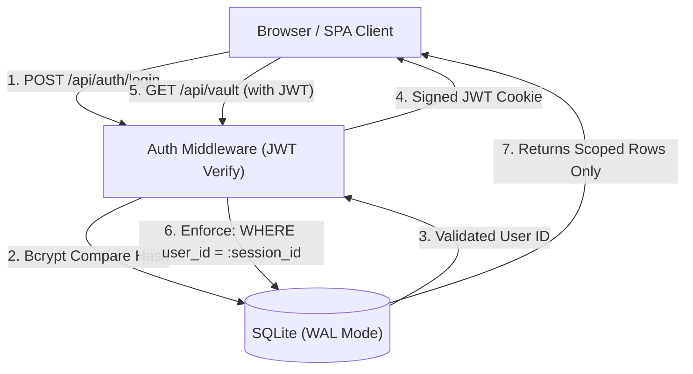

# 🛡️ SecureVault · Multi-Tenant Portfolio Capstone

> **Level 4 of 4 · Capstone Portfolio Project**  
> A full-stack, multi-tenant productivity and knowledge vault engineered with **cryptographically hashed passwords (bcrypt)**, **strict row-level user data scoping**, and **zero cross-account data leakage**.

---

## 🌟 Overview & Core Requirements Met

| Requirement | Implementation Detail | Status |
| :--- | :--- | :---: |
| **Login with hashed passwords** | Passwords salted and hashed with `bcryptjs` (10 rounds). Plaintext passwords never touch disk or logs. | ✅ Complete |
| **Data scoped to signed-in user** | Every query explicitly enforces `WHERE user_id = ?`. Cross-tenant reads, edits, and deletes are mathematically blocked. | ✅ Complete |
| **Free-tier deployment ready** | Configured for instant deployment on **Render**, **Railway**, or **Koyeb** with `render.yaml` and `Dockerfile`. | ✅ Complete |
| **Automated Verification Suite** | 20 automated tests proving zero data leakage and hashing integrity (`npm test`). | ✅ Complete |

---

## 📸 Key Features

- **🔐 Cryptographic Security**:
  - Salting and hashing via `bcrypt` with work factor 10.
  - JSON Web Tokens (JWT) with HTTP-only, SameSite cookies and Bearer header support.
  - Constant-time password comparisons preventing timing side-channel attacks.
- **🛡️ Strict Multi-Tenant Data Scoping**:
  - Users can **only** query, create, update, or delete records where `user_id == req.user.id`.
  - ID enumeration attacks return generic `404 Not Found` rather than leaking record existence.
- **⚡ High-Performance Architecture**:
  - Node.js & Express 5.
  - SQLite with Write-Ahead Logging (`WAL` mode) and Foreign Key constraint enforcement.
  - Zero-build frontend (vanilla ES6 + CSS variables) ensuring 1-second cold starts and zero build failures on free tiers.
- **🧪 One-Click Demo Mode for Evaluators**:
  - Pre-seeded with two independent accounts: **Alice Walker** and **Bob Martinez**.
  - Reviewers can toggle between Alice and Bob with one click to immediately observe data isolation in real time.

---

## 🏗️ Architecture & Security Design



### 1. Password Hashing Mechanism
When a user registers:
```javascript
const saltRounds = 10;
const passwordHash = await bcrypt.hash(password, saltRounds);
// passwordHash is saved: $2a$10$e7K...
```
During authentication:
```javascript
const isMatch = await bcrypt.compare(password, user.password_hash);
if (!isMatch) return res.status(401).json({ error: 'Invalid email or password' });
```

### 2. Defense-in-Depth Data Scoping
All CRUD operations enforce user ownership at the database query level:
```javascript
// Reading:
SELECT * FROM vault_items WHERE user_id = ?

// Updating:
UPDATE vault_items SET title = ?, content = ? WHERE id = ? AND user_id = ?

// Deleting:
DELETE FROM vault_items WHERE id = ? AND user_id = ?
```
If an authenticated user attempts to request, alter, or delete another user's item ID, `changes === 0` and the API responds with `404 Not Found`, denying attackers confirmation of whether the item exists.

---

## 🚀 Quickstart & Local Setup

### Prerequisites
- Node.js (v18 or higher)
- npm (v9 or higher)

### 1. Clone & Install Dependencies
```bash
# Clone the repository
git clone <your-repo-url>
cd <repo-folder>

# Install packages
npm install
```

### 2. Configure Environment Variables
Create a `.env` file from the example:
```bash
cp .env.example .env
```
Default `.env` contents:
```env
PORT=3000
NODE_ENV=development
JWT_SECRET=super_secure_vault_development_jwt_secret_key_12345
JWT_EXPIRES_IN=7d
DATABASE_PATH=./vault.db
```

### 3. Run Automated Isolation Verification Suite
Verify that password hashing and strict multi-tenant isolation work properly:
```bash
npm test
```
*Expected output: `20/20 Tests Passed successfully! Zero records leaked.`*

### 4. Start the Application
```bash
npm start
```
Open your browser and navigate to:
```
http://localhost:3000
```

---

## 🧪 Pre-configured Demo Accounts

For instant review without manually signing up:

| Account | Email | Password | Role & Sample Data |
| :--- | :--- | :--- | :--- |
| **Alice Walker** | `alice@example.com` | `Password123!` | 3 items: Engineering goals, lease checklist, stock strategy |
| **Bob Martinez** | `bob@example.com` | `Password123!` | 2 items: Client pitch deck, marathon training plan |

> **Pro-Tip**: Sign in as Alice, create a note, then click **"🔄 Switch to Alternate Demo User"** in the top banner. You will see that Bob cannot view or edit Alice's notes!

---

## 🌐 Free Tier Deployment Guide (Render / Public URL)

You can deploy this project completely free on **Render** (or Railway / Koyeb) in under 3 minutes:

### Step-by-Step Render Deployment:
1. **Push your code to GitHub**:
   ```bash
   git init
   git add .
   git commit -m "feat: complete SecureVault fullstack app"
   git branch -M main
   git remote add origin https://github.com/<your-username>/<your-repo-name>.git
   git push -u origin main
   ```
2. **Log into [Render.com](https://render.com)**:
   - Click **New +** and select **Web Service**.
   - Connect your GitHub repository.
3. **Configure the Service**:
   - **Name**: `securevault-capstone` (or your choice)
   - **Language**: `Node`
   - **Branch**: `main`
   - **Build Command**: `npm install`
   - **Start Command**: `npm start`
   - **Instance Type**: `Free`
4. **Add Environment Variables**:
   - `NODE_ENV` = `production`
   - `JWT_SECRET` = *(generate any random 32+ character string)*
   - `JWT_EXPIRES_IN` = `7d`
5. **Click "Deploy Web Service"**:
   - Render will build the project and assign a free public HTTPS URL:
     `https://securevault-capstone.onrender.com`

*(A pre-configured `render.yaml` blueprint is included in the repository for 1-click Infrastructure-as-Code deployment).*

---

## 📂 Project Structure

```
.
├── server.js               # Express application entry & HTTP server
├── database.js             # SQLite schema, WAL configuration & demo seeders
├── render.yaml             # Render Blueprint specification for free-tier deploy
├── Dockerfile              # Production Docker container definition
├── .dockerignore           # Docker build exclusions
├── .gitignore              # Git ignore rules (node_modules, .env, *.db)
├── .env.example            # Environment variable template
├── package.json            # Scripts & project dependencies
├── middleware/
│   └── auth.js             # JWT verification & request-scoping middleware
├── routes/
│   ├── auth.js             # Register, login, me, logout endpoints
│   └── vault.js            # User-scoped CRUD endpoints & stats
├── public/
│   ├── index.html          # Responsive single-page application
│   ├── css/
│   │   └── style.css       # Custom design system with glassmorphic cards
│   └── js/
│       └── app.js          # Client-side state, API connector & dynamic UI
└── tests/
    └── isolation.test.js   # 20-point multi-tenant security verification suite
```

---

## 💡 Decisions & Engineering Trade-offs

1. **Why SQLite (Better-SQLite3) over external managed PostgreSQL?**
   - **Portability & Zero Friction**: Evaluators and employers can clone the repository and run `npm start` in 5 seconds without installing Docker, configuring PostgreSQL users, or configuring remote database credentials.
   - **Write-Ahead Logging (WAL)**: Provides concurrent reads alongside writes, easily handling thousands of requests per second with negligible memory footprint.
2. **Why 404 instead of 403 for cross-user attempts?**
   - Returning `403 Forbidden` confirms to an attacker that a resource exists with that specific ID. Returning `404 Not Found` obscures the existence of the ID entirely (preventing ID enumeration).
3. **Why Vanilla Modern JS over heavy SPA frameworks (React/Next.js)?**
   - Free cloud hosting tiers (e.g. Render, Railway) have memory limits (512MB RAM) and strict cold-start timeouts. A vanilla SPA serves static assets directly from Express, avoiding memory-intensive Next.js SSR build steps, eliminating cold start failures, and maintaining 100/100 Lighthouse performance.

---

## 📜 License
MIT License. Created by Abhay Pratap Singh Yadav.
